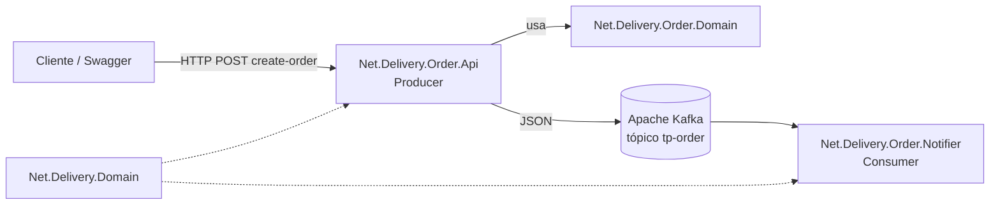
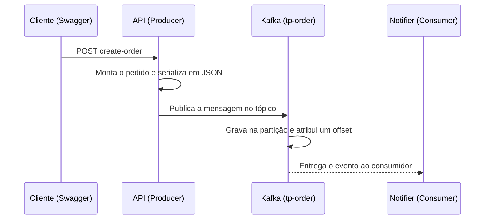

# 🚚 NetDelivery — Pedidos orientados a eventos com .NET e Apache Kafka


Aplicação de entrega de pedidos em **C# / .NET** que usa o **Apache Kafka** como message broker. Uma API REST recebe pedidos, publica cada um como evento no tópico `tp-order`, e um serviço consumidor (Notifier) é responsável por reagir a esses eventos.

O repositório une **código funcional** e **documentação prática** do que foi estudado e testado sobre Kafka (tópicos, partições, offsets, consumer groups, retenção e infraestrutura com Docker).

---

## 📌 Sumário

- [Resumo rápido](#-resumo-rápido)
- [Status do projeto](#-status-do-projeto)
- [Arquitetura](#-arquitetura)
- [Tecnologias](#-tecnologias)
- [Estrutura da solução](#-estrutura-da-solução)
- [Fluxo de uma mensagem](#-fluxo-de-uma-mensagem)
- [Como executar](#-como-executar)
- [Validando a comunicação](#-validando-a-comunicação)
- [Conceitos de Kafka aplicados](#-conceitos-de-kafka-aplicados)
- [Problemas reais encontrados e soluções](#-problemas-reais-encontrados-e-soluções)
- [Documentação técnica](#-documentação-técnica)
- [Próximas evoluções](#-próximas-evoluções)
- [Autor](#-autor)
- [Licença](#-licença)

---

## ⚡ Resumo rápido

| | |
|---|---|
| **Problema** | Desacoplar a criação de pedidos do processamento posterior, usando comunicação assíncrona. |
| **Solução** | API produtora → Apache Kafka → serviço consumidor, com infraestrutura local via Docker Compose. |
| **Padrões** | Arquitetura orientada a eventos (EDA), Producer/Consumer, separação em camadas/projetos. |
| **Stack** | C#, .NET Core, ASP.NET Core, Confluent.Kafka, Docker, Kafdrop, Swagger. |
| **Diferencial** | Documentação com comandos, saídas reais dos testes e erros diagnosticados durante o desenvolvimento. |

---

## ✅ Status do projeto

O que está validado e o que ainda falta, de forma transparente:

| Etapa | Status |
|---|---|
| Infraestrutura com Docker Compose (ZooKeeper, Kafka, Kafdrop) | ✅ Validado |
| Criação do tópico `tp-order` | ✅ Validado |
| API .NET em execução com Swagger | ✅ Validado |
| Criação de pedidos pelo endpoint `create-order` | ✅ Validado |
| Publicação das mensagens no Kafka | ✅ Validado |
| Leitura das mensagens com o console consumer | ✅ Validado |
| Visualização das mensagens no Kafdrop | ✅ Disponível |
| Processamento completo pelo **Notifier** | ⏳ Pendente de validação |

---

## 🏗️ Arquitetura



A API **não conhece** o consumidor: ela apenas publica o evento. Isso permite evoluir, escalar ou substituir o consumidor sem alterar o produtor.

---

## 🛠️ Tecnologias

| Tecnologia | Uso no projeto |
|---|---|
| C# / .NET Core | Linguagem e plataforma principal |
| ASP.NET Core | API REST de pedidos |
| Confluent.Kafka | Cliente Kafka para .NET (producer/consumer) |
| Apache Kafka | Plataforma de mensageria |
| Apache ZooKeeper | Coordenação do cluster Kafka (Kafka 3.0 / imagem Confluent) |
| Docker / Docker Compose | Infraestrutura local reproduzível |
| Kafdrop | Interface web para inspecionar tópicos, partições e mensagens |
| Swagger | Documentação e teste dos endpoints |
| Git / GitHub | Versionamento |

---

## 🗂️ Estrutura da solução

```text
netdelivery/
├── Net.Delivery.Domain/            # Domínio compartilhado
├── Net.Delivery.Order.Domain/      # Entidades e regras de pedido
├── Net.Delivery.Order.Api/         # API REST (producer Kafka)
├── Net.Delivery.Order.Notifier/    # Serviço consumidor
├── Documentação kafka-estudo/      # Colinha e anotações práticas de Kafka
├── Net.Delivery.sln
├── docker-compose.yml              # ZooKeeper + Kafka + Kafdrop
├── LICENSE
└── README.md
```

| Projeto | Responsabilidade |
|---|---|
| `Net.Delivery.Domain` | Camada de domínio compartilhada entre os serviços |
| `Net.Delivery.Order.Domain` | Modelo de pedido (id, datas, situação, itens, cliente) |
| `Net.Delivery.Order.Api` | Recebe requisições, monta o pedido e publica no Kafka |
| `Net.Delivery.Order.Notifier` | Consome os eventos de pedido |

---

## 🔄 Fluxo de uma mensagem



### Exemplo de mensagem

Formato observado nos testes (valores fictícios):

```json
{
  "OrderId": "3ff67072-0000-0000-0000-000000000000",
  "OrderCreateDate": "2026-11-14T21:55:59-03:00",
  "OrderLastUpdate": "2026-11-14T21:55:59-03:00",
  "OrderSituation": 0,
  "Items": ["Pizza"],
  "Customer": {
    "Name": "Victor",
    "PhoneNumber": "000000000",
    "Email": "cliente@example.com"
  }
}
```

| Campo | Descrição |
|---|---|
| `OrderId` | Identificador único do pedido, gerado pela API |
| `OrderCreateDate` / `OrderLastUpdate` | Data de criação e da última atualização |
| `OrderSituation` | Situação do pedido (`0` = recém-criado) |
| `Items` | Itens do pedido |
| `Customer` | Dados do cliente (nome, telefone, e-mail) |

---

## 🐳 Como executar

### Pré-requisitos

- [Git](https://git-scm.com/)
- [Docker Desktop](https://www.docker.com/products/docker-desktop/)
- [.NET SDK](https://dotnet.microsoft.com/download) compatível com o target dos projetos (atualmente `netcoreapp3.1`; veja [Próximas evoluções](#-próximas-evoluções))

### 1. Clonar o repositório

```bash
git clone https://github.com/ictor226/netdelivery.git
cd netdelivery
```

### 2. Subir a infraestrutura

```bash
docker compose up -d
```

Sobe ZooKeeper, Kafka e Kafdrop. Na primeira execução o Docker baixa as imagens (cerca de 1 minuto).

```bash
docker ps   # confira se zookeeper, kafka e kafdrop estão "Up"
```

| Serviço | Endereço |
|---|---|
| Kafka (de fora do Docker) | `localhost:9092` |
| Kafka (entre containers) | `kafka:29092` |
| Kafdrop (interface web) | http://localhost:9007 |

### 3. Criar o tópico de pedidos

```bash
docker exec -it kafka /bin/bash
cd /bin

./kafka-topics --create \
  --bootstrap-server localhost:9092 \
  --replication-factor 1 \
  --partitions 1 \
  --topic tp-order

./kafka-topics --list --bootstrap-server localhost:9092
```

> Nessa imagem (Confluent) os scripts **não** têm a extensão `.sh`.

### 4. Executar a API

Em outro terminal:

```bash
cd Net.Delivery.Order.Api
dotnet run
```

Acesse o Swagger em http://localhost:5000/swagger e use o endpoint `create-order`.

### 5. Consumir as mensagens

No terminal dentro do container do Kafka:

```bash
./kafka-console-consumer \
  --bootstrap-server localhost:9092 \
  --topic tp-order \
  --from-beginning
```

Cada pedido criado no Swagger aparece como uma linha JSON. As mesmas mensagens podem ser vistas no Kafdrop.

### Encerrando o ambiente

```bash
docker compose stop   # para os containers, mantendo tópicos e mensagens
docker compose down   # remove os containers (e, sem volumes, apaga os tópicos)
```

> ⚠️ O `docker-compose.yml` não define volumes. Com `down`, os tópicos e mensagens são perdidos. Persistência é uma das evoluções planejadas.

---

## 🔍 Validando a comunicação

O fluxo ponta a ponta testado até agora:

1. `docker compose up -d` sobe os três serviços.
2. O tópico `tp-order` é criado dentro do container.
3. A API inicia em `http://localhost:5000`.
4. Um pedido é criado pelo Swagger.
5. A mensagem JSON aparece no console consumer e no Kafdrop.

Também foram verificadas partições, offsets e lag com `kafka-topics --describe` e `kafka-consumer-groups --describe`.

---

## 📨 Conceitos de Kafka aplicados

| Conceito | O que foi praticado |
|---|---|
| **Topics** | Criação, listagem, descrição e exclusão (`tp-test`, `tp-order`) |
| **Partitions** | Aumento de partições e impacto na distribuição por chave (`hash(chave) % nº de partições`) |
| **Offsets** | Leitura com `print.offset`, `--from-beginning` e reset de offsets |
| **Producers** | Envio com e sem chave, via console e via API .NET |
| **Consumers** | Leitura desde o início, só de mensagens novas, com chave/partição/offset |
| **Consumer Groups** | Criação, `--describe`, leitura de lag, `--reset-offsets`, exclusão |
| **Retention** | Alteração de `retention.ms` com `kafka-configs` |
| **Replication / ISR** | Interpretação de Leader, Replicas e ISR no `--describe` |
| **Mensagens com chave** | A mesma chave cai na mesma partição, o que preserva a ordem por entidade |

Como a configuração aparece no .NET (Confluent.Kafka), em paralelo ao que foi feito no terminal:

```csharp
var producerConfig = new ProducerConfig
{
    BootstrapServers = "localhost:9092"   // equivale a --bootstrap-server
};

var consumerConfig = new ConsumerConfig
{
    BootstrapServers = "localhost:9092",
    GroupId = "cgp-test",                          // equivale a --group
    AutoOffsetReset = AutoOffsetReset.Earliest     // semelhante a --from-beginning
};
```

---

## 🧩 Problemas reais encontrados e soluções

Registro de diagnósticos feitos durante o desenvolvimento (detalhes completos na documentação técnica):

| Problema | Causa | Solução |
|---|---|---|
| `NU1605` — downgrade de `Confluent.Kafka` (2.16.0 → 2.3.0) | A API referenciava uma versão menor que a exigida pelo projeto Domain | Alinhar a versão no `.csproj` da API para `2.16.0` |
| Consumer com `null` colado no valor / chave vazia no producer | `;` sem aspas no terminal separa comandos, e o `key.separator` chega vazio | Usar sempre `--property "key.separator=;"` |
| Grupo `cgp-teste` criado sem aviso | Erro de digitação no `--group`; o Kafka cria grupos novos silenciosamente | Conferir o nome do grupo e validar com `--list` |
| App .NET sem conectar ao Kafka no Docker | Diferença entre listeners interno e externo | `KAFKA_ADVERTISED_LISTENERS` com `kafka:29092` (containers) e `localhost:9092` (host) |
| Conflito de porta 9092 | Kafka local ainda em execução | Encerrar o Kafka local antes de usar o do Docker |
| `bash: cd: bin: No such file or directory` | Scripts ficam em `/bin` na raiz do container | Usar `cd /bin` |

---

## 📚 Documentação técnica

A pasta [`Documentação kafka-estudo`](./Documenta%C3%A7%C3%A3o%20kafka-estudo) reúne as anotações práticas do estudo, organizadas em duas partes:

- **Parte 1 — Comandos**, na ordem em que foram testados (copiar e colar): tópicos, producer, consumer, consumer groups, Docker e execução da API.
- **Parte 2 — Dicas e explicações**: significado de cada flag, leitura do `--describe`, chave vs. sem chave, offset e lag, conceitos (broker, partição, ISR, retenção), explicação do `docker-compose.yml` e tabela de erros comuns.

---

## 🚀 Próximas evoluções

| Evolução | Objetivo |
|---|---|
| Finalizar e validar o Notifier | Fechar o fluxo completo produtor → Kafka → consumidor |
| Atualizar o target de `netcoreapp3.1` | Migrar para uma versão do .NET com suporte (ex.: .NET 8) |
| Tratamento de exceções | Maior confiabilidade no processamento |
| Retry Pattern | Novas tentativas em falhas temporárias |
| Dead Letter Queue (DLQ) | Isolar mensagens que não puderem ser processadas |
| Idempotência | Evitar efeitos duplicados ao reprocessar eventos |
| Testes automatizados | Unitários e de integração |
| Observabilidade | Logs estruturados, métricas e rastreamento |
| Persistência de dados | Armazenar pedidos em banco de dados |
| Volumes no Docker Compose | Manter tópicos e mensagens entre reinicializações |

---

## 👨‍💻 Autor

**Victor Huggo**
Desenvolvedor backend com foco em C# e .NET, interessado em arquitetura de software, mensageria e sistemas distribuídos.

- GitHub: [@ictor226](https://github.com/ictor226)

---

## 📄 Licença

Distribuído sob a licença MIT. Consulte o arquivo [LICENSE](./LICENSE) para mais informações.
